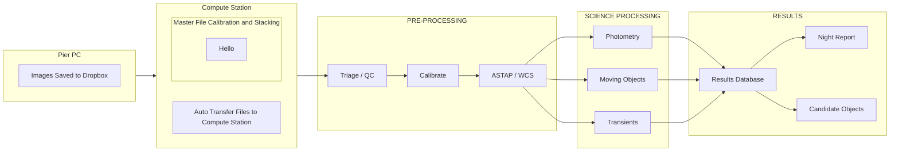
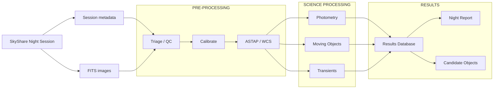

# SkyStack

Small automation toolkit for stacking and calibrating astrophotography FITS frames using PixInsight CLI.

## Quick overview

- Transfer/organize frames from Dropbox: [auto_transfer.py](auto_transfer.py)  
- Build master calibration frames (flats/darks): [stack_flats.py](stack_flats.py), [stack_darks.py](stack_darks.py) which reuse shared logic in [stack_calibration_frames.py](stack_calibration_frames.py)  
- Calibrate light frames and create reports/plots: [calibrate_images.py](calibrate_images.py)  
- PixInsight automation JS scripts used by the CLI wrapper: [pixscripts/basic_stack_script.js](pixscripts/basic_stack_script.js), [pixscripts/calibration_script.js](pixscripts/calibration_script.js)

Core helpers are in the `astro_utils` package:
- Config loader: [`astro_utils.config_loader.load_config`](astro_utils/config_loader.py) ([file](astro_utils/config_loader.py))  
- File operations: [`astro_utils.file_ops.ensure_dir`](astro_utils/file_ops.py), [`astro_utils.file_ops.get_target_name`](astro_utils/file_ops.py) ([file](astro_utils/file_ops.py))  
- FITS header helpers: [`astro_utils.fits_helpers.read_fits_header_info`](astro_utils/fits_helpers.py) ([file](astro_utils/fits_helpers.py))  
- PixInsight CLI wrapper: [`astro_utils.pixinsight_cli.stack_with_pixinsight`](astro_utils/pixinsight_cli.py), [`astro_utils.pixinsight_cli.calibrate_with_pixinsight`](astro_utils/pixinsight_cli.py) (`astro_utils/pixinsight_cli.py`)

Config file: [config.yaml](config.yaml) — edit paths, tolerances and behavior there (PixInsight CLI path, base directories, tolerances, etc.).



## Pipeline (`run_routine.py`)

```sh
python run_routine.py run    -t "M 31" [-s 2024-12-05 ...] --triage local   # everything, reviewing here
python run_routine.py run    -t "M 31" --triage send     # up to sending the triage page to reviewers
python run_routine.py finish -t "M 31" decisions.json [...]  # once reviewers send decisions back
python run_routine.py status -t "M 31"                       # what each stage last did
```

The order is:

1. transfer from Dropbox *(optional, `--skip-transfer`)*
2. master flats/darks *(optional, `--skip-masters`)*
3. **calibrate** the lights
4. **measure** the calibrated lights with SubframeSelector *(`--skip-measure`)*
5. **reference** (plate-solved canvas)
6. **register**
7. **triage**: blink + subframe selector. `--triage local` opens the tool on this computer and, after
   *Finish review*, carries on with 8–10; `--triage send` sends the page to reviewers and stops
   (`finish` picks up from there)
8. **stack**
9. **postprocess**, e.g. BlurXTerminator *(optional, `--postprocess`)*
10. **export** the client zip *(`--export`; by default only for `client_export.client_targets`)*

Every stage is also its own subcommand (`python run_routine.py -h`), e.g. `triage --local` to review
frames already registered. `-s/--session` limits a run to session folders under `LIGHT/<target>/`.

| Stage | What it does | Output (under `REGISTERED/<target>/`) |
|---|---|---|
| measure | PixInsight SubframeSelector on the calibrated lights: FWHM, eccentricity, stars, PSF signal weight, PSF SNR, noise, ... ([pixscripts/measure_script.js](pixscripts/measure_script.js)). Stored in `skystack.db`, keyed by the raw frame, so they follow it through registration. | `skystack.db` |
| reference | Plate solves every calibrated frame with ASTAP and builds a canvas covering the **union** (or **intersection**, `registration.canvas`) of their footprints. One real frame is resampled onto it as the reference. `--reference-frame FILE` registers against a chosen light instead. | `reference/` |
| register | PixInsight StarAlignment of all calibrated lights onto the reference ([pixscripts/registration_script.js](pixscripts/registration_script.js)). | `registered/` |
| triage | Builds **one self-contained HTML page** of auto-stretched previews. Blink with ←/→/Space, reject with X. The **subframe selector** on the right shows a histogram of a metric for the current frame's filter/exposure group, with its bin highlighted; cuts set there reject frames in the blink view too (X keeps one anyway). Finishing shows a per-filter summary. Sent pages download a small `decisions.json`, copied via `remote_triage.outbox_dir` / Discord (`SKYSTACK_DISCORD_WEBHOOK`); local review posts the decisions straight back and closes. | `triage/` |
| apply-triage | Checks the decision file(s) against the package they belong to. A frame any reviewer (or cut) rejected is rejected. | `BLINKED/`, `REJECTED/` |
| stack | For each filter/exposure group: first-pass integration → LocalNormalization → final ImageIntegration with LN data, PSF Signal Weight and rejection chosen by frame count ([pixscripts/integration_script.js](pixscripts/integration_script.js)). The previous master is kept in `master/superseded/`. | `master/`, `ln/` |
| postprocess | Presets applied in order to the masters, e.g. BlurXTerminator correct-only ([skystack/postprocess.py](skystack/postprocess.py), [pixscripts/postprocess_script.js](pixscripts/postprocess_script.js)). Manually processed files can be saved here too. | `processed/` |
| export | Zip of the masters (and `processed/`, `--processed`) plus an integration summary. Optionally adds the raw LIGHTs (`--raw-lights kept\|all`) and the master flats/darks that calibrated them (`--with-calibration`). `add-processed` adds the processed masters to an existing zip. | `client_export.output_dir/<target>/` |

**From the dashboard** (`streamlit run skystack_ui.py`): pick a target to see its counts (lights,
calibrated, measured, registered, kept, yield, masters) and its latest job with a live log and a
Cancel button. Its tabs:

- **Run pipeline**: the 10 steps above; **Run** starts them as a background job ([skystack/jobs.py](skystack/jobs.py)).
  With *Review here*, the triage tool pops up in its own window when the frames are ready.
- **Triage**: open the triage tool on frames that are already registered (waiting ones, or all of them
  to redo a triage, WBPP group folders included), send pages to reviewers, and apply their decision files.
- **Masters & export**: the masters and corrected masters, post-processing, the client zip, and adding
  corrected masters to the last zip.
- **Details**: the target's folders and `pipeline_state.json`.

Jobs keep running if the page is closed. Status and logs live in `pipeline_jobs/`, and only one job runs
at a time because all PixInsight work shares one set of control files.

Settings live under `registered_output_dir`, `measurement`, `platesolve`, `registration`,
`remote_triage`, `stacking`, `postprocess` and `client_export` in [config.yaml](config.yaml).

## Remote access (collaborators over Tailscale)

`python skystack_server.py` runs the dashboard for collaborators, with the triage tool in their own
browser. It starts, all on `127.0.0.1` only:

- the dashboard (port 8501)
- the web triage server (port 8502)
- the job queue

[Tailscale](https://tailscale.com) publishes these on your tailnet and tells the app who each visitor
is, so there are no passwords. Settings are under `remote_access` in [config.yaml](config.yaml)
([skystack/remote_access.py](skystack/remote_access.py)).

| Who | Can | Jobs |
|---|---|---|
| You on this PC (`http://localhost:8501`), or a login in `owners` | everything, any time | start at once (or queue behind a running one) |
| A login in `collaborators` | the full dashboard, only inside `windows` (default 22:00–07:00) | queue; start only inside a window; with `auto_run: false` they wait for your **Approve** (sidebar) |
| Anyone else | nothing | — |

From the sidebar you can open or close access by hand ("open now for 2 hours"), and approve, reject or
cancel requests. **Review in your browser** (Triage tab) builds the triage page and lists a link under
*Open reviews*. *Finish review* there queues the rest (stack → [post-process] → [export]) as that
person's request. No job waits while a review is open.

Setup, once:

1. Install Tailscale on this PC, and have collaborators join your tailnet (or
   [share this machine](https://tailscale.com/kb/1084/sharing) with them).
2. In `config.yaml`, set `remote_access.enabled: true`, your own login under `owners`, and each
   collaborator under `collaborators`, e.g. `pal@example.com: {auto_run: false}`.
3. Publish the two servers on the tailnet (HTTPS, tailnet only, not the public internet):
   ```sh
   tailscale serve --bg http://127.0.0.1:8501
   tailscale serve --bg --set-path /triage http://127.0.0.1:8502/triage
   ```
   or set `manage_tailscale_serve: true` to have `skystack_server.py` publish them only while access is
   open. Owners connecting remotely are then limited to the window too.
4. Run `python skystack_server.py` from your logged-in session: a Task Scheduler task *At log on*, not a
   Windows service, because PixInsight needs the desktop. Keep the PC from sleeping during the window.
   Collaborators open `https://<this-pc>.<tailnet>.ts.net/`.

**Trying a collaborator's view from this PC** (no Tailscale or second device needed): add a test login
under `collaborators` (e.g. `test@example.com: {auto_run: false}`), start `python skystack_server.py`, and
open two tabs:

- `http://localhost:8501/`: you, the owner
- `http://localhost:8501/?as=test@example.com`: that collaborator

The collaborator tab shows a *Test mode* notice. It's refused outside the window: use the owner tab's
sidebar to open or close access. Its jobs wait for the owner tab's **Approve**, and its web reviews are
submitted as that login. `?as=` (or `skystack_server.py --act-as LOGIN` for every tab) only applies to
visits from this PC and only ever lowers access; it's ignored for anything coming through Tailscale.

Notes:

- Use `skystack_server.py` instead of `streamlit run skystack_ui.py` for remote use. A plain
  `streamlit run` listens on every network interface, and anyone reaching it through another address
  than localhost is refused.
- If you use PixInsight yourself while a collaborator's job runs, BlurXTerminator falls back to the CPU
  (see `pixinsight_gpu`). That's one more reason the window also limits when their jobs start.

## Requirements

- Python 3.8+
- Packages (example): astropy, numpy, matplotlib, pandas, pyyaml
Install with pip, e.g.:
```sh
pip install astropy xisf numpy matplotlib pandas pyyaml
```

## Usage
- Ensure config.yaml is configured for your environment (paths, PixInsight path, directories).
- Transfer files from Dropbox:
  ```
  python auto_transfer.py
  ```
- Create master flats/darks:
    ```
    python stack_flats.py
    python stack_darks.py
    ```
    Masters are produced in the directories set by flat_master_output / dark_master_output in [config.yaml](config.yaml).
- Calibrate lights and generate summary plots:
    ```
    python calibrate_images.py
    ```
    or call `plot_summary()` directly on an existing calibration log JSON found in each calibrated target folder.


## Notes & pointers
- PixInsight execution: the wrapper writes JSON into C:/Temp/PixStack and runs PixInsight with `--run` pointing to the JS scripts. Verify the PixInsight executable path in [config.yaml](config.yaml) and/or `astro_utils.pixinsight_cli.PIXINSIGHT_PATH`.
- The JS scripts read JSON files generated by the Python wrappers: `input_files.json` and `params.json` in `C:/Temp/PixStack`.
Logging: scripts use Python logging; change `log_level` in `config.yaml`.
If you need to adapt grouping/metadata logic, see `astro_utils.fits_helpers.read_fits_header_info` and `stack_calibration_frames.stack`.


# Future steps

We plan to incorporate a science pipeline that will likely follow this diagram:

